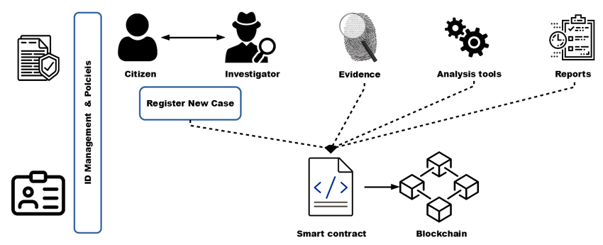
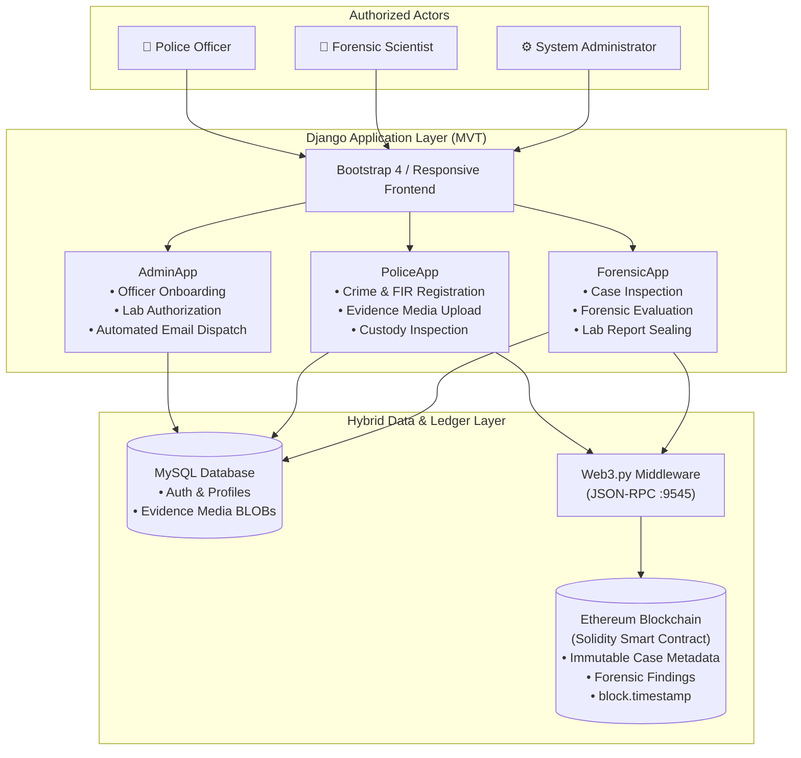
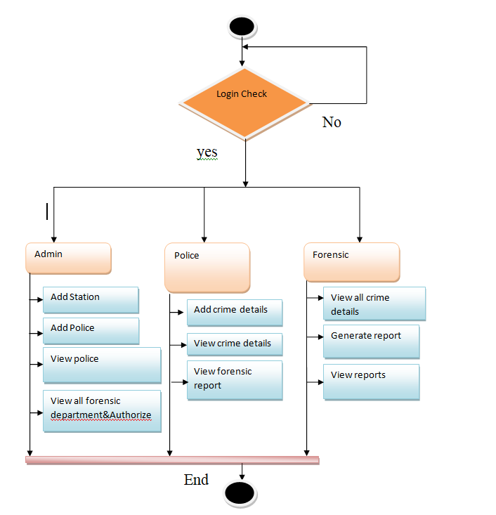
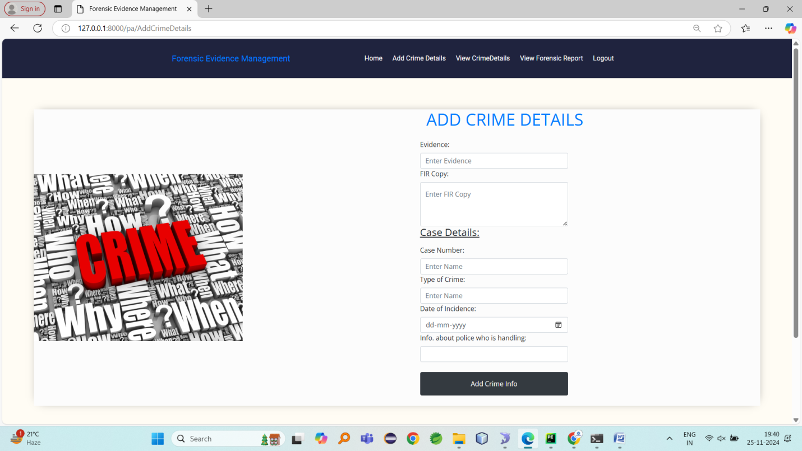
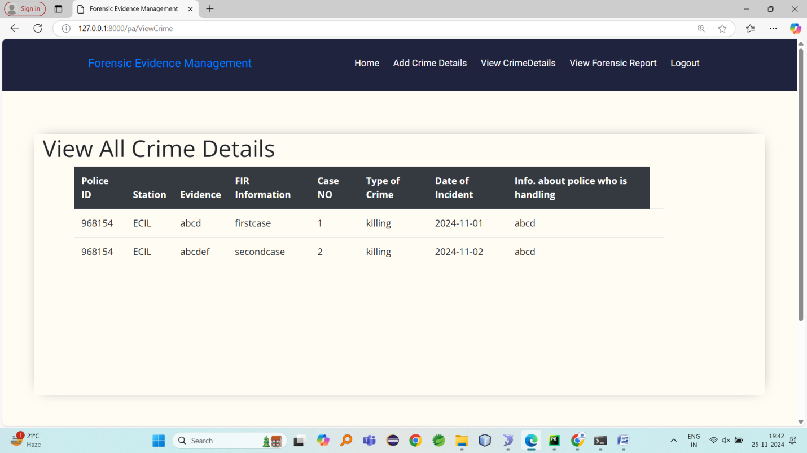
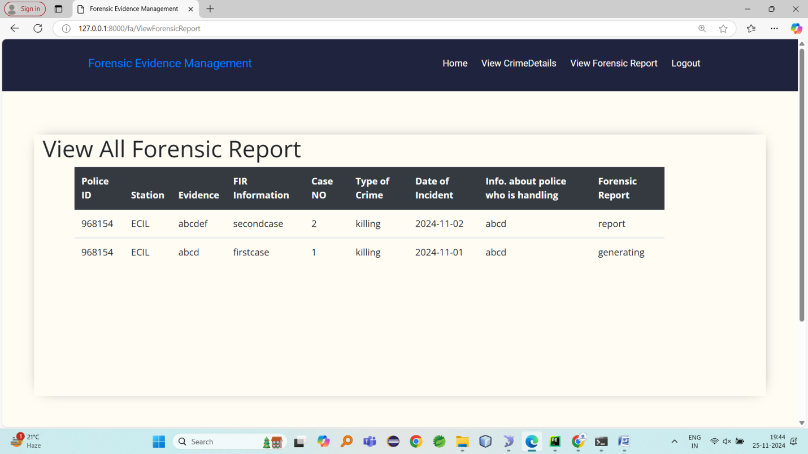

# 🛡️ Blockchain-Based Forensic Evidence Management System
### *Establishing an Immutable & Verifiable Chain of Custody (CoC) using Ethereum Smart Contracts & Django*

<div align="center">

[](https://www.python.org/)
[](https://www.djangoproject.com/)
[](https://soliditylang.org/)
[](https://web3py.readthedocs.io/)
[](https://www.mysql.com/)
[](LICENSE)

</div>

---

## 📌 Executive Summary

Forensic evidence is the foundation of criminal justice, directly determining whether suspects are convicted or exonerated. However, traditional evidence tracking mechanisms—often relying on paper logs and centralized relational databases—are vulnerable to:
- **Insider Tampering & Corruption**: Unauthorized modifications or record deletions in centralized databases.
- **Accidental Loss & Human Error**: Misplaced evidence logs or inaccurate manual timestamps.
- **Disputed Chain of Custody in Court**: Inability to mathematically prove that evidence remained pristine between seizure, laboratory analysis, and judicial presentation.

This project implements an **enterprise-grade, decentralized Forensic Evidence Management System**. By integrating a **Full-Stack Django web portal** with a **private Ethereum blockchain (Ganache/Truffle)** via **Solidity Smart Contracts**, the system provides cryptographic proof of existence, immutable chronological audit trails, and strict role-based access control for law enforcement and forensic science laboratories.

---

## 📐 System Architecture

The application adopts a **hybrid storage architecture**: structured profiles, officer credentials, and large binary media (BLOBs) are maintained in MySQL, while critical evidence metadata, case associations, and forensic reports are anchored directly into Ethereum blocks.

<div align="center">
  
</div>

### Layer Breakdown



---

## 🚀 Key Features

* **🔗 Immutable Chain of Custody (CoC)**:
  Every evidence logging action, transfer, and forensic laboratory examination is permanently recorded on the Ethereum blockchain. Records cannot be edited, overwritten, backdated, or purged.
* **⏰ Tamper-Proof EVM Timestamps**:
  Timestamps are obtained directly from Ethereum block headers (`block.timestamp`), preventing client-side date manipulation.
* **👥 Role-Based Access Control (RBAC)**:
  - **Police Module**: Register new FIRs, record crime incident parameters, upload evidence photos, and track laboratory status.
  - **Forensic Module**: Access authorized case evidence, perform scientific examination, and publish tamper-proof laboratory findings.
  - **Admin Module**: Onboard verified police stations, dispatch auto-generated credentials via SMTP email, and authorize laboratory examiners.
* **🔐 Dual-Storage Optimization**:
  Eliminates excessive gas costs by storing binary media in MySQL while anchoring cryptographic records and audit strings on Ethereum.
* **🛡️ Courtroom-Ready Verification**:
  Provides an end-to-end, chronological audit log that can be validated by judges and legal counsels.

---

## 🔄 End-to-End Workflow

<div align="center">
  
</div>

1. **Station Onboarding**: The Administrator registers a new Police Officer and assigns a station. The system generates a unique 6-digit Police ID and secure password, instantly delivering them via automated email.
2. **Lab Vetting**: Forensic examiners register and remain in a `waiting` state until verified and authorized by the Administrator.
3. **Evidence Seizure**: A Police Officer registers a crime case, uploads physical/digital evidence images, and triggers an on-chain transaction via `setData()`.
4. **Forensic Examination**: The certified forensic laboratory retrieves the pending evidence, conducts diagnostics, and writes the definitive forensic conclusion directly to the blockchain via `setReport()`.
5. **Chain of Custody Review**: Both Police and judicial authorities can view the unified report containing timestamped records from seizure to scientific conclusion.

---

## 📸 Key Application Walkthrough

### 1. Police Evidence Registration
Officers enter case numbers, incident dates, crime categories, FIR details, handling officer details, and evidence photos. The system verifies case number uniqueness across the blockchain before dispatching the transaction.

<div align="center">
  
</div>

---

### 2. Live Chain of Custody & Evidence Records
All submitted cases and corresponding evidence photos are listed with their blockchain validation status, allowing officers to track case handovers in real time.

<div align="center">
  
</div>

---

### 3. Blockchain-Verified Forensic Report
Once the forensic scientist finishes evaluation, the final conclusion is committed to the Ethereum ledger. The report displays the immutable block-anchored forensic findings.

<div align="center">
  
</div>

---

## 📜 Smart Contract Architecture (`Crime_SmartContract.sol`)

The system's core consensus logic is governed by an Ethereum smart contract written in **Solidity 0.8.11**:

```solidity
pragma solidity >= 0.8.11 <= 0.8.11;

contract Crime_SmartContract {

    struct filedata {
        uint timestamp;
        string data;
    }

    struct requestdata {
        uint timestamp;
        string rptdata;
    }

    filedata[] public fdata;
    requestdata[] public rdata;

    // Registers police evidence data with block timestamp
    function setData(string memory r) public {
        filedata memory newContent = filedata({
            data: r,
            timestamp: block.timestamp
        });
        fdata.push(newContent);
    }

    // Fetches all recorded evidence records
    function getData() public view returns (filedata[] memory) {
        return fdata;
    }

    // Registers forensic laboratory analysis report
    function setReport(string memory rr) public {
        requestdata memory newContent = requestdata({
            rptdata: rr,
            timestamp: block.timestamp
        });
        rdata.push(newContent);
    }

    // Fetches all forensic lab reports
    function getReport() public view returns (requestdata[] memory) {
        return rdata;
    }
}
```

---

## 🛠️ Tech Stack & Requirements

| Component | Technology | Version |
|---|---|---|
| **Backend Framework** | Django | 2.2+ |
| **Language** | Python | 3.8+ |
| **Smart Contracts** | Solidity | 0.8.11 |
| **Blockchain Suite** | Truffle / Ganache | Port 9545 |
| **Web3 Connector** | Web3.py | 5.x+ |
| **Database** | MySQL Server / PyMySQL | 5.7+ / 8.0+ |
| **Frontend** | HTML5, CSS3, JavaScript, Bootstrap | 4.x |

---

## ⚙️ Installation & Setup Guide

### 1. Clone the Repository
```bash
git clone https://github.com/Premsai19/Block-chain-project.git
cd Block-chain-project
```

### 2. Set Up Virtual Environment & Dependencies
```bash
# Create virtual environment
python -m venv venv

# Activate virtual environment
# Windows:
venv\Scripts\activate
# Linux/macOS:
source venv/bin/activate

# Install requirements
pip install -r requirements.txt
```

### 3. Configure MySQL Database
1. Start your local MySQL server.
2. Create the project database:
   ```sql
   CREATE DATABASE forensic_evidence;
   ```
3. Import the SQL schema:
   ```bash
   mysql -u root -p forensic_evidence < "An impl/DATABASE/Database.sql"
   ```
4. Verify or update MySQL credentials in `An impl/SOURCE CODE/ForensicEvidence/Database.py` (default: `root`/`root`).

### 4. Start Local Ethereum Blockchain (Ganache)
1. Start Ganache GUI or CLI listening on port `9545`:
   ```bash
   ganache-cli -p 9545
   ```
2. Deploy `Crime_SmartContract.sol` using Truffle or Remix, and ensure the deployed contract address matches the address configured in `PoliceApp/views.py` and `ForensicApp/views.py`:
   ```python
   deployed_contract_address = '0xa3d4B74f4ac0365439efd1D9D718aa13c56412e1'
   ```

### 5. Launch Django Server
```bash
cd "An impl/SOURCE CODE/ForensicEvidence"
python manage.py runserver
```
Open `http://127.0.0.1:8000/` in your browser.

---

## 📂 Project Structure

```text
Block-chain-project/
├── docs/
│   └── images/                     # Curated architecture diagrams & interface visuals
│       ├── system_architecture.png
│       ├── workflow_diagram.png
│       ├── police_evidence_entry.png
│       ├── evidence_chain_of_custody.png
│       └── forensic_report_verification.png
├── An impl/
│   ├── BASEPAPER/                  # IEEE Base Paper reference
│   ├── DATABASE/                   # Database.sql MySQL schema
│   ├── DOCUMENT/                   # Abstract, documentation & UML models
│   └── SOURCE CODE/
│       └── ForensicEvidence/
│           ├── AdminApp/           # Administrator views, officer registration & authorization
│           ├── PoliceApp/          # Crime & evidence logging, Web3 blockchain calls
│           ├── ForensicApp/        # Lab report creation & verification
│           ├── ForensicEvidence/   # Project settings, URL routing & WSGI
│           ├── Static/             # CSS, JS, and UI design assets
│           ├── Templates/          # HTML Templates for all roles
│           ├── Crime_SmartContract.sol   # Solidity smart contract
│           ├── Crime_SmartContract.json  # Contract ABI & deployment metadata
│           ├── Database.py         # MySQL connection handler
│           └── manage.py           # Django management script
├── .gitignore
├── requirements.txt
└── README.md
```

---

## 👨‍💻 Author

**Prem Sai Chithaluri**
* **GitHub**: [@Premsai19](https://github.com/Premsai19)
* **LinkedIn**: [Prem Sai Chithaluri](https://linkedin.com/in/premsai-chithaluri)
* **Email**: premsaichithaluri@gmail.com

---

## 📄 License

This project is open-source under the [MIT License](LICENSE).
